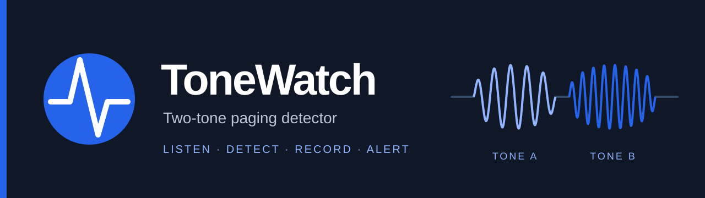
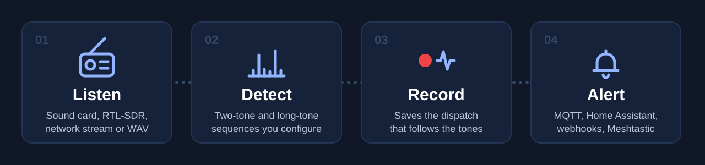

<!-- markdownlint-disable MD013 MD033 MD041 -- centered banner and badges need HTML; prose is unwrapped for GitHub rendering -->
<p align="center">
  
</p>

<p align="center">
  <a href="https://github.com/JustBeanie/tonewatch/releases/latest"></a>
  <a href="https://github.com/JustBeanie/tonewatch/actions/workflows/ci.yml"></a>
  <a href="https://github.com/JustBeanie/tonewatch/pkgs/container/tonewatch"></a>
  <a href="https://github.com/JustBeanie/ha-tonewatch"></a>
  <a href="LICENSE"></a>
</p>

<p align="center">
  <a href="https://justbeanie.github.io/tonewatch/"><b>Documentation</b></a> ·
  <a href="#quick-start"><b>Quick start</b></a> ·
  <a href="https://github.com/JustBeanie/ha-tonewatch"><b>Home Assistant</b></a> ·
  <a href="https://github.com/JustBeanie/tonewatch/issues"><b>Get help</b></a>
</p>

**ToneWatch listens to a radio channel, recognizes the paging tones you care about, records the dispatch that follows, and tells you about it** on your phone, in Home Assistant, over MQTT, or through a webhook. It runs on a Raspberry Pi, any Docker host, or Windows, and you manage it from a web page in your browser.

<p align="center">
  
</p>

> [!IMPORTANT]
> ToneWatch is a **supplemental** notification tool, not a certified primary alerting system. Keep an independently supervised path for emergency notifications. Recording or rebroadcasting radio traffic may be regulated where you live; you are responsible for following the rules that apply to you.

## Features

| | |
| --- | --- |
| 🎧 **Any audio source** | A USB sound card from a scanner, an RTL-SDR dongle, an HTTP/RTSP audio stream, or a WAV file for testing. |
| 🎯 **Accurate tone detection** | Two-tone and long-tone sequences, with per-tone-set tolerances, squelch, and a live spectrum to capture frequencies straight from the air. |
| 🎙️ **Automatic recordings** | Saves the dispatch audio after each page and keeps a call history you can play back. |
| 🔔 **Alerts where you want them** | MQTT (with Home Assistant discovery), signed webhooks, Meshtastic mesh radios, or a local script. |
| 🔎 **Discovered tones** | Collects tone pairs that don't match anything yet, with audio clips, so you can turn them into new tone sets. |
| 🗺️ **Agencies and CAD** | Attach agency details and coverage maps to tone sets, and enrich pages with incidents from a CAD feed. |
| 📻 **Listen live** | Optional short-lived MP3 restream of a source to your browser or a speaker. |
| 🏠 **Home Assistant** | A dedicated [integration](https://github.com/JustBeanie/ha-tonewatch) with event entities, controls, and recordings in the Media tab. |

## Quick start

You need a computer with [Docker](https://docs.docker.com/get-docker/) and an audio source. These steps use a network audio stream because it needs no extra hardware.

1. **Download a compose file and start ToneWatch:**

   ```sh
   curl -O https://raw.githubusercontent.com/JustBeanie/tonewatch/main/docker/compose.stream.yml
   docker compose -f compose.stream.yml up -d
   ```

2. **Get your sign-in token.** ToneWatch creates one on first start:

   ```sh
   docker compose -f compose.stream.yml exec tonewatch cat /data/api_token
   ```

3. **Open <http://localhost:8099>** (or your server's address), sign in with the token, and add your stream under **Sources**.

4. **Add a tone set** for each department you want to watch. If you don't know the frequencies, use the [live spectrum to capture them](https://justbeanie.github.io/tonewatch/guide/finding-frequencies/), or let [Discovered tones](https://justbeanie.github.io/tonewatch/guide/discovered-tones/) collect them for you.

5. **Add an alert target** (MQTT, webhook, or Meshtastic) and use the tone set's **Test** button to check that alerts arrive.

Using a scanner with a sound card, or an RTL-SDR dongle? Swap in [`compose.soundcard.yml`](docker/compose.soundcard.yml) or [`compose.rtlsdr.yml`](docker/compose.rtlsdr.yml); the [install guides](#install) explain the device setup.

## Install

| Platform | Guide |
| --- | --- |
| 🐳 Docker (Linux, amd64 or arm64) | [Docker guide](https://justbeanie.github.io/tonewatch/install/docker/) |
| 🍓 Raspberry Pi (64-bit OS) | [Raspberry Pi guide](https://justbeanie.github.io/tonewatch/install/raspberry-pi/) |
| 🪟 Windows | Download the zip from the [latest release](https://github.com/JustBeanie/tonewatch/releases/latest), then follow the [Windows guide](https://justbeanie.github.io/tonewatch/windows/) |
| 🏠 Home Assistant OS | Preview: experimental app in [JustBeanie/ha-addons](https://github.com/JustBeanie/ha-addons) ([status](https://justbeanie.github.io/tonewatch/install/home-assistant-addon/)) |

Already using a `tones.cfg` file from another tool? [Import it](https://justbeanie.github.io/tonewatch/guide/importing-tones-cfg/) instead of retyping your tone sets.

## Home Assistant

Two ways to connect, and you can use both:

- **[ToneWatch integration](https://github.com/JustBeanie/ha-tonewatch)** (HACS, recommended): event entities for each tone set, health sensors, enable switches and test buttons, ready-made blueprints, and recordings plus live feeds in the **Media** tab.
- **MQTT discovery**: turn on `ha_discovery` on an MQTT alert target. See the [Home Assistant recipes](https://justbeanie.github.io/tonewatch/guide/home-assistant/).

## Documentation

The full guide lives at **[justbeanie.github.io/tonewatch](https://justbeanie.github.io/tonewatch/)**. Good places to start:

- [Find tone frequencies](https://justbeanie.github.io/tonewatch/guide/finding-frequencies/) and [tune detection](https://justbeanie.github.io/tonewatch/guide/tuning/)
- [Troubleshoot a missed page](https://justbeanie.github.io/tonewatch/guide/troubleshooting/) by replaying a recording through the analyzer
- [Listen live](https://justbeanie.github.io/tonewatch/guide/listen-live/), [Agencies](https://justbeanie.github.io/tonewatch/guide/agencies/), [CAD feeds](https://justbeanie.github.io/tonewatch/guide/cad/), and [Meshtastic](https://justbeanie.github.io/tonewatch/guide/meshtastic/)
- [Administration](https://justbeanie.github.io/tonewatch/guide/admin/): tokens, backups, and restore

## Getting help

- **Something not working?** Start with [Troubleshoot missed pages](https://justbeanie.github.io/tonewatch/guide/troubleshooting/), then [open an issue](https://github.com/JustBeanie/tonewatch/issues/new/choose).
- **Have an idea?** [Request a feature](https://github.com/JustBeanie/tonewatch/issues/new/choose).
- **Found a security problem?** Please report it privately as described in [SECURITY.md](SECURITY.md).

Don't post API tokens, recordings, or incident addresses in public issues.

## Contributing

Contributions are welcome. You'll need [uv](https://docs.astral.sh/uv/), Node.js 24, pnpm 10, and [just](https://github.com/casey/just):

```sh
just setup   # install backend and web dependencies
just check   # lint, type-check, and test everything
```

Read [CONTRIBUTING.md](CONTRIBUTING.md) before opening a pull request. The roadmap is in [PLAN.md](PLAN.md).

## License

ToneWatch is released under the [Apache License 2.0](LICENSE). Bundled third-party components are listed in [THIRD_PARTY_NOTICES.md](THIRD_PARTY_NOTICES.md).
